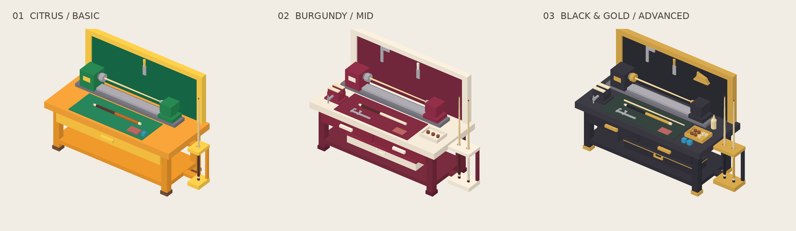

# 三档球杆维修工作台

根据本次确认的三张低面概念图制作，使用 Three.js / TypeScript 几何体直接构建，没有把概念图贴在平面上，也不依赖外部模型或纹理服务。

上图直接读取工作台的实际三角网格，通过软件深度缓冲投影生成，仅用于核对造型、遮挡和配色；不代表 WebGL 运行效果或完整界面验收。另已生成六个机位共 18 张临时几何预览，修正了背板与桌面、侧框之间的细缝。

## 入口与复杂度

| 房间参数 | 配色 | 内容 | 工作台网格数 | 三角面 |
| --- | --- | --- | ---: | ---: |
| `room=workshop-citrus` | 橘黄绿 | 单抽屉、单球杆、一件挂墙工具、空下层 | 52 | 1,000 |
| `room=workshop-burgundy` | 酒红白 | 双抽屉、双球杆、台钳、卡尺、配件托盘、长杆盒 | 88 | 1,708 |
| `room=workshop-blackgold` | 黑金 | 三件挂墙工具、备用杆身、胶水、皮头及空心套箍、工具箱和杆盒 | 107 | 2,212 |

统计只包含工作台，独立空间另有一块 12 面地台。材质使用纯色色块和低面法线；黑金只有少量低金属度金色部件，没有增加雕花、细密木纹或高密度曲面。

三个入口均加入原有「选择房间」，初始为隐藏人物的工作台观察模式。它们共享底层模型构造器，但每个入口只创建自己的工作台和灯光。旋转、缩放、昼夜和亮度按钮可用；手机有独立旋转摇杆。行走模式保留人物与地台寻路，工作台和球杆架是固定碰撞体，没有床、马桶和座椅动作。

## 分组与复用

- `variants.ts`：三档配置、配色、关键尺寸和仅用于自动截图的机位。
- `geometry.ts`：方块、八边圆柱、真实开孔杆架、空心套箍和统计函数。
- `workbench.ts`：`createCueWorkbench(variant)` 返回独立 `THREE.Group`。
- `index.ts`：`createCueWorkshop(variant)` 装配地台、灯光、导航和工作台。

工作台根节点保留 `bench-frame`、`tool-board`、`cue-lathe`、`work-surface`、`cue-rack`、`storage` 六个分组，进阶和高级另有 `bench-vise`。抽屉、车床主轴/尾座、挂墙工具、球杆、托盘及杆盒都有稳定名称。原点为桌体下方地面中心，Y 轴向上，Z 正方向是抽屉正面，单位为米；可以独立调用构造器用于其他场景。

## 衔接原则

- 夹头、尾座和待修杆身共用同一根 X 向轴线，杆身端部进入夹持件。
- 杆架上板是真正开孔的挤出几何体，球杆不贯穿实心板；下板承托球杆底部。
- 皮头是独立八边柱，套箍保留空心孔。
- 脚套接地；杆盒和工具箱落在下层板顶；垫板落在桌面顶；拆开的杆尾各段连续连接。
- 地台在左右和后方留出人物通行空间，阻止人物穿过工作台与球杆架。

## 验证

`tests/cue-workshop.test.ts` 检查三档几何有效性、严格递增且不超过 2,500 面的预算、车床同轴和端点接触、杆架孔/套箍孔的射线通透性、接地和承托关系，以及碰撞和绕行路线。加入后全仓 80 项测试与生产构建通过。

当前受控预览浏览器不支持 WebGL，无法在该浏览器内验收。新增 `Cue workshop visual review` 工作流，在 GitHub Actions 的 Chromium/SwiftShader 环境生成三款的轴测、正面、背面、俯视、车床近景、杆架近景，另有三张手机竖屏和一张黑金夜间界面图，共 22 张。截图和错误报告保存在该次运行的 `cue-workshop-review` 临时构建产物，待检查后记录结果。

本次本地代码已经提交。向公开远程仓库的推送被自动审批拦截，要求用户对具体公开地址再次确认；尚未合入远程 main，三个新入口还未上线。目标已经从既有项目记录确认是 `https://github.com/GioGyan90/RoomBoy`。收到明确确认后推送特性分支，运行并检查截图流程；再基于远程最新 main 合入，等待 GitHub Pages 部署完成。
